# Семинар 3. CLIP и SigLIP: классификация через текст и межмодальный поиск

## 1. Окружение и данные

Эксперимент выполнен в Google Colab на GPU. Фактическая конфигурация среды:

| Компонент | Значение |
|---|---|
| Устройство | CUDA GPU (T4) |
| Python | 3.13.15 |
| PyTorch | 2.11.0+cu130 |
| Transformers | 5.18.0 |
| Датасет | CIFAR-10 |
| Проверочная выборка | 200 изображений, по 20 на класс |
| Тестовая выборка | 500 изображений, по 50 на класс |
| Seed | 42 |

Первоначально заданные версии `torch==2.5.1` и `torchvision==0.20.1` установить не удалось: для Python 3.13 отсутствовал подходящий пакет `torchvision==0.20.1`. Эксперимент продолжен на предустановленных версиях Colab. В Transformers 5 методы `get_image_features` и `get_text_features` возвращают объект результата, поэтому из него явно извлекался `pooler_output`.

Использовались контрольные точки:

- `openai/clip-vit-base-patch32`;
- `google/siglip-base-patch16-224`.

Точные хеши ревизий в текстовый вывод экспортированного ноутбука не попали. Код сохраняет их в `results_seminar3/environment.json`, однако сам каталог Colab вместе с ноутбуком не выгружался. Индексы выборок были зафиксированы и сохранены в `results_seminar3/split.json`.

Обе выборки сбалансированы. В каждом из десяти классов присутствует одинаковое число изображений.

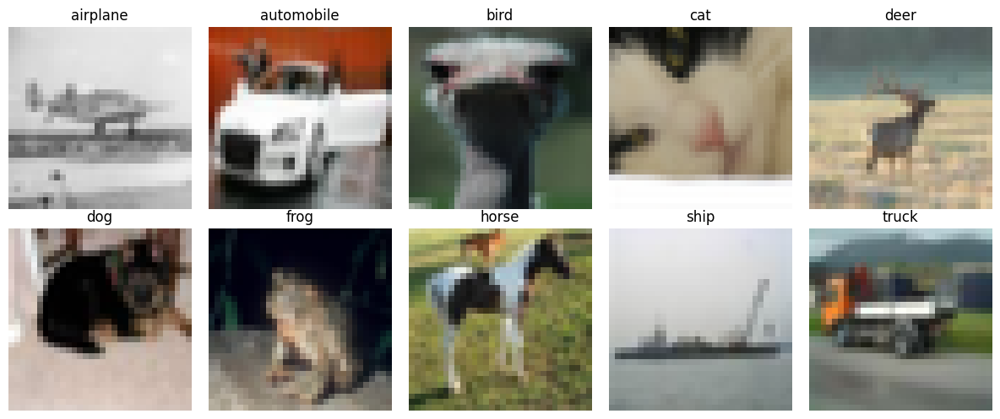

## 2. Классификация без обучения

Для каждого изображения вычислялся нормированный визуальный вектор, а для каждого класса — нормированный текстовый прототип. Класс выбирался по максимальному косинусному сходству.

Формы тензоров:

| Модель | `image_test` | `prototypes['photo']` | Матрица сходств |
|---|---:|---:|---:|
| CLIP | 500 × 512 | 10 × 512 | 500 × 10 |
| SigLIP | 500 × 768 | 10 × 768 | 500 × 10 |

Строка матрицы сходств содержит оценки одного изображения для десяти текстовых классов. Столбец соответствует одному текстовому прототипу. Признаки конечны и нормированы, а ручные логиты совпали с выходом моделей. Масштаб логитов CLIP равен 100.0. Для SigLIP получены масштаб 117.3308 и смещение −12.9324.

### Проверочная выборка

| Модель | Шаблон | Accuracy | Macro-F1 |
|---|---|---:|---:|
| CLIP | `name` | 0.855 | 0.8535 |
| CLIP | `photo` | 0.875 | 0.8723 |
| CLIP | `sentence` | 0.875 | 0.8717 |
| CLIP | `ensemble` | 0.875 | 0.8734 |
| SigLIP | `name` | 0.920 | 0.9209 |
| SigLIP | `photo` | **0.935** | **0.9355** |
| SigLIP | `sentence` | 0.920 | 0.9197 |
| SigLIP | `ensemble` | 0.915 | 0.9153 |

Случайный выбор одного класса из десяти дал бы ожидаемую accuracy 0.10, поэтому результаты обеих моделей существенно выше случайного уровня. Для CLIP три варианта достигли одинаковой accuracy 0.875. По заранее заданному правилу равенства выбран первый из них — `photo`. Для SigLIP шаблон `photo` оказался однозначно лучшим.

Ансамбль не обязан улучшать качество. Усреднение прототипов может сместить вектор от наиболее удачной формулировки. Это видно у SigLIP: ансамбль дал 0.915 против 0.935 у `photo`.

### Тестовая выборка

| Модель | Выбранный шаблон | Accuracy | Macro-F1 |
|---|---|---:|---:|
| CLIP | `a photo of a {}.` | 0.906 | 0.9048 |
| SigLIP | `a photo of a {}.` | **0.940** | **0.9403** |

На тестовой выборке SigLIP лучше CLIP на 3.4 процентного пункта по accuracy. Эту разницу нельзя приписывать только функции потерь: контрольные точки отличаются архитектурой, размером патча, данными и процедурой предобучения.

### Матрицы ошибок

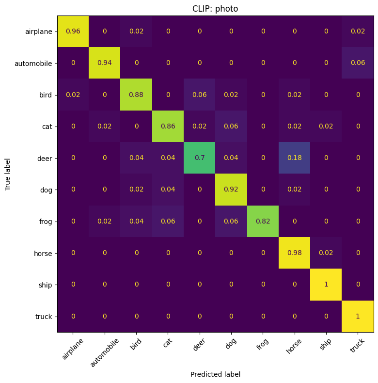

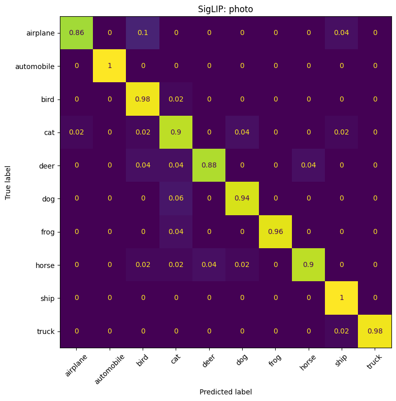

У CLIP наиболее трудным оказался класс `deer`: правильно распознано 70% изображений, а 18% отнесены к `horse`. Для `cat` accuracy равна 86%, причём 6% изображений попали в `dog`. Для `dog` правильная доля выше — 92%, а ошибка `dog → cat` составляет 4%. Классы транспорта различаются увереннее: `ship` и `truck` распознаны без ошибок, а `automobile` в 6% случаев спутан с `truck`.

У SigLIP взаимная путаница кошек и собак меньше: `cat` распознан в 90% случаев, `dog` — в 94%. Модель особенно хорошо сработала на `automobile` и `ship` — 100%. Заметная ошибка возникла для `airplane`: 10% изображений отнесены к `bird`. Вероятная причина — общий силуэт объекта на фоне неба при разрешении CIFAR-10 32 × 32.

## 3. Формулировки и уверенность

Положительный общий масштаб логитов не меняет порядок классов: умножение всех значений на одно положительное число сохраняет отношения «больше — меньше». Общее смещение также не меняет порядок.

Для одного тестового изображения истинного класса `bird` получены следующие значения:

| Модель | Кандидат | Softmax, 3 класса | Softmax, 10 классов | Sigmoid |
|---|---|---:|---:|---:|
| CLIP | airplane | 0.0163 | 0.0007 | 1.0000 |
| CLIP | automobile | 0.0559 | 0.0024 | 1.0000 |
| CLIP | bird | 0.9278 | 0.0404 | 1.0000 |
| SigLIP | airplane | 0.0002 | 0.00002 | 0.000002 |
| SigLIP | automobile | 0.00003 | 0.000004 | 0.0000004 |
| SigLIP | bird | 0.9998 | 0.1319 | 0.0117 |

При добавлении кандидатов исходные попарные логиты не меняются, но знаменатель softmax увеличивается. Поэтому softmax-оценка `bird` снизилась с 0.9278 до 0.0404 у CLIP и с 0.9998 до 0.1319 у SigLIP. Sigmoid применяется к каждой паре независимо, поэтому его значения не зависят от остальных кандидатов.

Sigmoid логитов CLIP не является штатной мерой соответствия. Полученные единицы для всех трёх кандидатов показывают, что такая интерпретация бессмысленна. Для SigLIP истинный класс победил с sigmoid 0.0117, то есть универсальный порог 0.5 отверг бы корректный результат. Без отдельной калибровки эти значения нельзя трактовать как вероятности события на CIFAR-10.

## 4. Межмодальный поиск

Релевантными считались все тестовые изображения того же класса, что и текстовый запрос. Для каждого из десяти классов ранжировались 500 изображений, после чего рассчитывались средние метрики Top-5.

| Модель | Precision@5 | Recall@5 | Hit@5 |
|---|---:|---:|---:|
| CLIP | 0.980 | 0.098 | 1.000 |
| SigLIP | **1.000** | **0.100** | **1.000** |

В каждом классе имеется 50 релевантных изображений, поэтому максимально возможный Recall@5 равен 5/50 = 0.1. SigLIP достиг этого максимума: все 50 позиций в десяти списках Top-5 релевантны. CLIP допустил одну ошибку среди 50 позиций. Для каждой модели хотя бы одно релевантное изображение найдено по каждому запросу, поэтому Hit@5 равен 1.0.

### Галереи CLIP

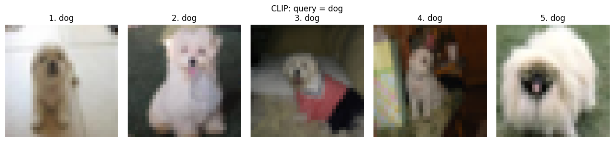

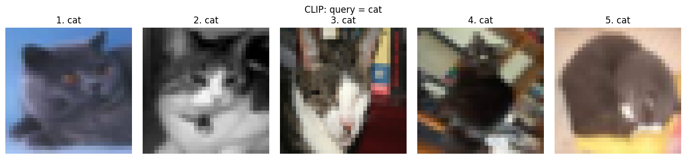

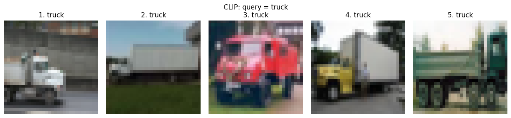

### Галереи SigLIP

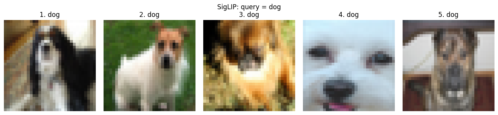

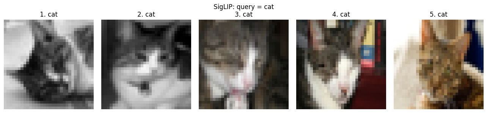

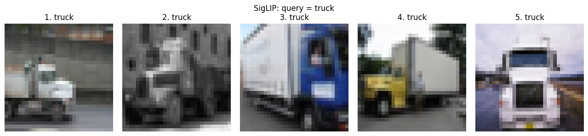

### Разбор ошибок

В сохранённых Top-5 результатах присутствует только одна фактическая ошибка поиска: CLIP по запросу `horse` поставил изображение класса `deer` на первое место с косинусным сходством 0.2881.

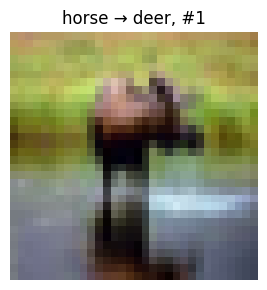

На изображении виден четырёхногий объект на зелёном фоне. При исходном разрешении 32 × 32 почти исчезают форма головы, рога и другие признаки, позволяющие отличить оленя от лошади. Доминируют общий силуэт, ноги и сцена с травой, поэтому ошибка объяснима сходством визуальных признаков.

Требование разобрать три ошибочных результата поиска буквально выполнить на полученном Top-5 нельзя: эксперимент дал только одну такую ошибку, а у SigLIP их не было. Выдумывать дополнительные ошибки было бы некорректно. Два других заметных случая относятся к классификации:

1. `deer → horse` у CLIP встречается в 18% изображений класса. Причина та же: близкие силуэты крупных четвероногих и потеря мелких деталей.
2. `airplane → bird` у SigLIP встречается в 10% изображений класса. На малом разрешении крылья и контрастный объект на фоне неба могут давать похожую глобальную форму.

Добавление общего смещения SigLIP не меняет поисковое ранжирование, так как к каждой оценке прибавляется одна и та же константа. Смешивать текстовые признаки SigLIP с визуальным индексом CLIP нельзя: энкодеры обучены в разных координатных пространствах. Совпадение размерностей, если бы оно возникло, не означало бы семантической совместимости осей.

## 5. Функции потерь

### Численные проверки

| Loss | Нулевые логиты | Хорошая матрица | Переставленная матрица |
|---|---:|---:|---:|
| CLIP | 1.386294 | 0.00000036 | 16.000000 |
| SigLIP | 2.772589 | 0.001342 | 16.00134 |

При размере пакета B = 4 нулевые логиты дают:

- CLIP: ln 4 = 1.386294, поскольку softmax равномерно распределён между четырьмя кандидатами;
- SigLIP: 4 ln 2 = 2.772589 при нормировке суммы по B, поскольку каждая из 16 бинарных пар даёт ln 2.

Хорошая матрица имеет большие положительные диагональные логиты и большие отрицательные внедиагональные, поэтому обе потери близки к нулю. После перестановки столбцов правильные пары оказываются на неверных позициях, и обе потери возрастают примерно до 16. Числа CLIPLoss и SigLIPLoss нельзя напрямую сравнивать как общую шкалу качества: у функций разные цели и нормировки.

При B = 1 CLIPLoss равна нулю: единственный элемент строки и столбца не имеет конкурирующего отрицательного примера. SigLIPLoss остаётся равной ln 2 для нулевого логита, потому что задача всё ещё содержит одну положительную бинарную пару.

### Смещение и градиенты

Для B = 4 оптимальное смещение постоянного бинарного классификатора равно

`−ln(B − 1) = −ln 3 = −1.098612`.

Вычисленный градиент в этой точке равен нулю. При нулевых логитах получены матрицы градиентов:

```text
CLIP:
[[-0.1875,  0.0625,  0.0625,  0.0625],
 [ 0.0625, -0.1875,  0.0625,  0.0625],
 [ 0.0625,  0.0625, -0.1875,  0.0625],
 [ 0.0625,  0.0625,  0.0625, -0.1875]]

SigLIP:
[[-0.1250,  0.1250,  0.1250,  0.1250],
 [ 0.1250, -0.1250,  0.1250,  0.1250],
 [ 0.1250,  0.1250, -0.1250,  0.1250],
 [ 0.1250,  0.1250,  0.1250, -0.1250]]
```

Отрицательный градиент на диагонали означает, что градиентный спуск увеличивает логиты положительных пар. Положительный внедиагональный градиент уменьшает логиты отрицательных пар. В симметричной CLIPLoss каждая ячейка участвует одновременно в строковой и столбцовой нормировке.

Переход от `sum()/B` к `mean()` добавил бы деление ещё на B, поскольку `mean()` усредняет B² элементов. При B = 4 градиенты стали бы в четыре раза меньше.

### Ложные отрицательные

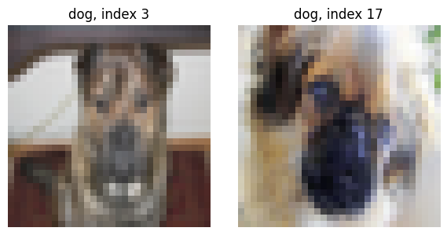

Оба изображения соответствуют описанию `a photo of a dog`, но при строго диагональной разметке пара «первое изображение — описание второго» считалась бы отрицательной. Это не ошибка `cross_entropy`, а следствие неверно построенной разметки пар. Функция потерь оптимизирует именно переданные цели и не знает, что несколько объектов имеют одинаковую семантику.

Для классовой маски с двумя объектами каждого класса бинарная цель корректно пометила внедиагональные пары внутри класса положительными. Полученная потеря равна 2.772589, а градиенты этих пар отрицательны, то есть оптимизация повышает их логиты.

Если изменить долю положительных пар, изменится оптимальный логит постоянного классификатора: он соответствует log-odds новой доли положительных. Поэтому вместе с балансом пар меняется и интерпретация sigmoid-оценки.

## 6. Выводы

Формулировка текста заметно влияет на качество. Для обеих моделей лучший результат на проверочной выборке дал шаблон `a photo of a {}.`. У CLIP переход от одного имени класса к этому шаблону повысил accuracy с 0.855 до 0.875. У SigLIP прирост составил с 0.920 до 0.935. Усреднение нескольких формулировок не гарантирует улучшения.

На тестовой выборке SigLIP показал более высокое качество классификации и идеальный Precision@5 в данном поисковом опыте. Однако эксперимент сравнивает две готовые контрольные точки целиком. Он не позволяет заключить, что преимущество вызвано исключительно sigmoid loss: одновременно отличаются архитектура, размер патча, состав данных и режим предобучения.

Результаты поиска по названиям классов показывают хорошее выравнивание глобальных визуальных и текстовых признаков, но не доказывают понимание пространственных отношений, количества объектов или композиции сцены. CIFAR-10 также ограничивает выводы низким разрешением изображений. Для надёжного порога отказа потребовалась бы отдельная размеченная калибровочная выборка с релевантными и нерелевантными парами, включая примеры вне десяти классов.

Подбор шаблона выполнялся по размеченной проверочной выборке, поэтому это не полностью строгий режим без целевой разметки. Строгому zero-shot протоколу соответствовал бы заранее зафиксированный шаблон `photo` без сравнения вариантов на CIFAR-10.
